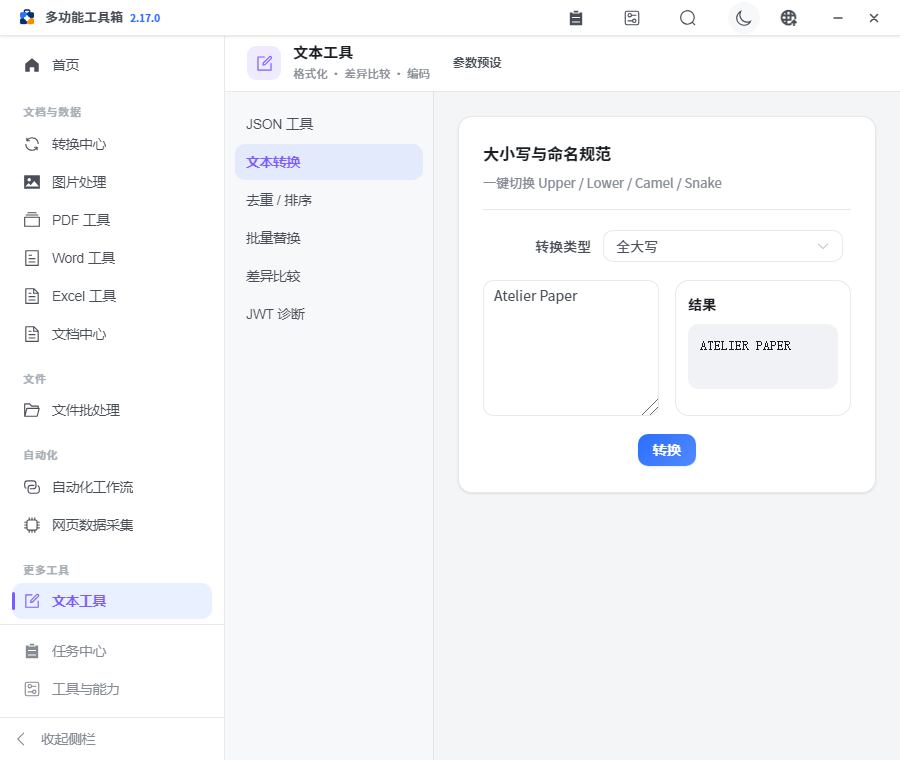
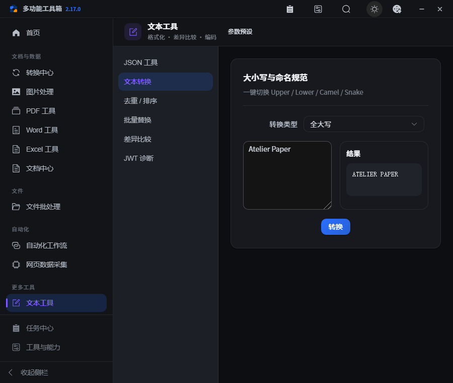

# PPX v2.17.0 — 功能回归与界面修正

本版检查现有工具和完整处理链路，修正小图水印及首页键盘行为，改善文本工具的窄窗口布局与结果反馈；不新增模块、运行依赖或数据迁移。

## 修正与调整

- 图片水印：小图、水印较大或默认边距超过剩余空间时，定位限制在可见范围，避免整个水印落在画布外；平铺模式保持原行为。
- 首页收藏：常用动作主按钮与收藏按钮并列，鼠标、Enter 和空格均由原生按钮处理，收藏不再意外打开工具，键盘焦点清晰可见。
- 文本工作区：在窄窗口将输入与输出并排、操作单独成行，更窄时纵向排列；差异统计改为双列，减少拥挤。
- 结果区：使用已有明暗主题变量，空结果显示提示，移除浅色界面中固定的深色空块及多余阴影。
- 版本显示：标题栏直接读取前端包版本，避免发版时仍显示旧版本。

## 验证范围

在 Windows 开发环境运行完整 Python 回归、前端契约检查、ESLint / Ruff、生产构建、真实 API 浏览器流程，以及独立视觉与文本交互检查。统计和证据见 [verification.json](assets/v2.17.0/verification.json)。

新增默认回归验证真实文件内容，而不只验证成功状态：

- PDF：文件/页码选择顺序、合并、拆分、切割、非法页码、压缩产物、按页文本提取、图片提取与尺寸过滤。
- Word：按标题和段落拆分后的实际段落内容、找不到指定标题的反馈。
- 图片：格式、尺寸、压缩后可读取、小图文字水印、裁剪几何与拼接像素顺序。
- 转换中心：图片转两页 PDF、PDF 合并、PNG 转 JPEG；未安装引擎时明确跳过，已安装时处理失败直接使测试失败。
- 视频：FFmpeg 可用时实际生成音视频样本，检查压缩、截取、音频提取、拼接后的流类型与时长，以及越界截取错误。

浏览器继续验证文件搜索归档、Excel 清洗和质检、失败重试、来源与结果接力、工作流模板及续跑、千页 PDF 页面编辑和网页采集。新增检查覆盖收藏键盘交互、JSON 格式化与错误反馈、文本转换、去重、替换与非法正则；默认端到端命令同时运行这些检查。模块导航冒烟与实际处理验证分开记录。

## 验收边界与发布

- 14 个模块在本机完成导航冒烟；这不表示所有子功能和参数组合均完成了人工验收。系统诊断受平台限制。
- 本机缺少 LibreOffice 和 OCR 运行依赖，相应真实页码处理、OCR 及依赖它们的转换未作为通过项；单元测试中的替身不替代真实引擎验收。
- 原生安装、升级、恢复、系统剪贴板和原生文件对话框仍保持 [pending](../refactor-acceptance.json)。测试中的对话框与剪贴板使用隔离桥接。
- 按 2026-10-16 的明确发版要求，在验证通过、提交并推送后推送附注 Tag。Windows、macOS、Linux 自动检查与打包全部成功后，GitHub 才创建正式 Release；自动构建不等同于原生安装验收。
